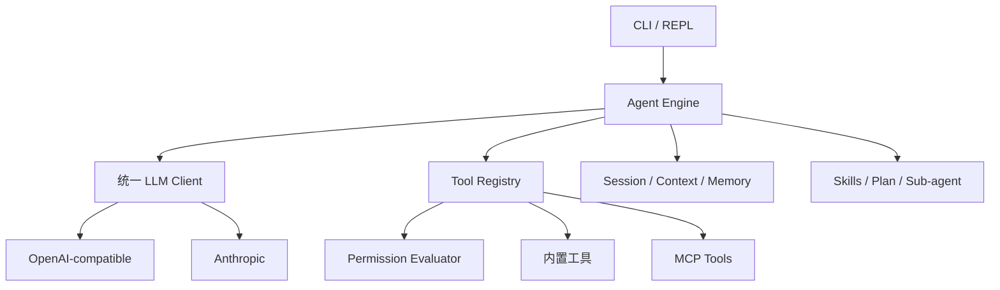

# Mini Claude Go

[](https://github.com/Hiiii113/mini-claude-go/actions/workflows/ci.yml)
[](https://github.com/Hiiii113/mini-claude-go/actions/workflows/release.yml)
[](LICENSE)

一个使用 Go 从头实现的命令行编码 Agent。它兼容 Anthropic 原生协议和 OpenAI-compatible 协议，提供文件操作、Shell、上下文压缩、会话恢复、记忆、Skills、子 Agent、Plan Mode 与 MCP 工具扩展。

> 本项目用于学习、实验和个人开发，目前全程使用 codex 实现，仅用于 agent 方向学习用途

## 特性

- 单个 Go 二进制，可在 Windows、Linux 和 macOS 运行
- Anthropic 与 OpenAI-compatible 双后端，支持自定义 API 地址
- 流式输出、thinking 内容、工具调用与 token/费用统计
- 12 个内置工具，包括文件读写、精确编辑、正则搜索、Shell 和网页读取
- 五种权限模式，包含危险命令确认和 read-before-edit 防护
- REPL 与 one-shot 两种运行方式，支持会话保存、恢复和上下文压缩
- 项目记忆、Skills、Plan Mode、内置及自定义子 Agent
- MCP JSON-RPC 2.0 stdio 客户端，可动态发现并调用外部工具
- 默认测试不连接真实模型，提供 19 项兼容性验收清单

## 工作方式



## 快速开始

### 方式一：下载 Release 直接使用（推荐）

使用 Release 不需要安装 Go 或 Git，只需要一个可用的模型 API Key。

#### 1. 选择正确的安装包

打开 [最新 Release 页面](https://github.com/Hiiii113/mini-claude-go/releases/latest)，在 **Assets** 中根据系统和 CPU 下载文件，同时下载 `SHA256SUMS`：

| 系统 | CPU | 应下载的文件 |
| --- | --- | --- |
| Windows 64 位普通电脑 | Intel / AMD | `mini-claude-go_<版本>_windows_amd64.zip` |
| Windows ARM 电脑 | ARM64 | `mini-claude-go_<版本>_windows_arm64.zip` |
| Linux 64 位普通电脑 | Intel / AMD | `mini-claude-go_<版本>_linux_amd64.tar.gz` |
| Linux ARM 设备 | ARM64 | `mini-claude-go_<版本>_linux_arm64.tar.gz` |
| macOS Intel | Intel | `mini-claude-go_<版本>_darwin_amd64.tar.gz` |
| macOS Apple Silicon | M1 / M2 / M3 / M4 | `mini-claude-go_<版本>_darwin_arm64.tar.gz` |

不知道 CPU 架构时可以执行：

```powershell
# Windows：通常显示 AMD64 或 ARM64
$env:PROCESSOR_ARCHITECTURE
```

```bash
# Linux / macOS：x86_64 对应 amd64，arm64 或 aarch64 对应 arm64
uname -m
```

#### 2. 校验下载文件（推荐）

下面以 `v0.1.0` 为例；使用其他版本时替换文件名。

Windows PowerShell：

```powershell
$asset = "mini-claude-go_0.1.0_windows_amd64.zip"
$expected = (Select-String -Path .\SHA256SUMS -Pattern ([regex]::Escape($asset))).Line.Split()[0]
$actual = (Get-FileHash ".\$asset" -Algorithm SHA256).Hash.ToLower()
$actual -eq $expected
```

输出 `True` 表示校验通过。

Linux：

```bash
grep 'mini-claude-go_0.1.0_linux_amd64.tar.gz' SHA256SUMS | sha256sum -c -
```

macOS：

```bash
grep 'mini-claude-go_0.1.0_darwin_arm64.tar.gz' SHA256SUMS | shasum -a 256 -c -
```

#### 3. 解压

Windows PowerShell：

```powershell
Expand-Archive .\mini-claude-go_0.1.0_windows_amd64.zip -DestinationPath .
Set-Location .\mini-claude-go_0.1.0_windows_amd64
.\mini-claude.exe --help
```

Linux：

```bash
tar -xzf mini-claude-go_0.1.0_linux_amd64.tar.gz
cd mini-claude-go_0.1.0_linux_amd64
chmod +x mini-claude
./mini-claude --help
```

macOS Apple Silicon：

```bash
tar -xzf mini-claude-go_0.1.0_darwin_arm64.tar.gz
cd mini-claude-go_0.1.0_darwin_arm64
chmod +x mini-claude
./mini-claude --help
```

#### 4. 配置模型并运行

临时配置只对当前终端有效，适合首次测试。

Windows PowerShell 使用 Anthropic：

```powershell
$env:ANTHROPIC_API_KEY = "your-anthropic-api-key"
$env:ANTHROPIC_MODEL = "claude-sonnet-4-5"
.\mini-claude.exe
```

Windows PowerShell 使用 OpenAI-compatible：

```powershell
$env:OPENAI_API_KEY = "your-openai-api-key"
$env:OPENAI_MODEL = "gpt-4.1-mini"
# $env:OPENAI_BASE_URL = "https://api.openai.com/v1"
.\mini-claude.exe
```

Linux / macOS 使用 Anthropic：

```bash
export ANTHROPIC_API_KEY="your-anthropic-api-key"
export ANTHROPIC_MODEL="claude-sonnet-4-5"
./mini-claude
```

也可以把压缩包中的 `.env.example` 复制为当前工作目录下的 `.env`，然后填写配置：

```powershell
# Windows
Copy-Item .env.example .env
notepad .env
```

```bash
# Linux / macOS
cp .env.example .env
${EDITOR:-nano} .env
```

程序读取的是**启动命令所在工作目录**中的 `.env`。如果要在其他代码项目中使用，请设置系统/用户环境变量，或者在目标项目中放置已被 `.gitignore` 排除的 `.env`。不要提交真实 API Key。

执行一次任务并退出：

```powershell
.\mini-claude.exe "阅读当前项目并说明入口文件的作用"
```

```bash
./mini-claude "阅读当前项目并说明入口文件的作用"
```

### 方式二：从源码运行或安装

需要 Go 1.26.2 或更高版本以及 Git：

```bash
go version
git clone https://github.com/Hiiii113/mini-claude-go.git
cd mini-claude-go
```

复制并编辑配置模板：

```powershell
# Windows
Copy-Item .env.example .env
notepad .env
```

```bash
# Linux / macOS
cp .env.example .env
${EDITOR:-nano} .env
```

启动 REPL：

```bash
go run .
```

执行一次任务并退出：

```bash
go run . "阅读当前项目并说明入口文件的作用"
```

构建到被 Git 忽略的 `bin/` 目录：

```powershell
# Windows
New-Item -ItemType Directory -Force bin | Out-Null
go build -trimpath -o .\bin\mini-claude.exe .
.\bin\mini-claude.exe --help
```

```bash
# Linux / macOS
mkdir -p bin
go build -trimpath -o ./bin/mini-claude .
./bin/mini-claude --help
```

也可以使用 Go 安装：

```bash
go install .
```

可执行文件会安装到 `go env GOBIN` 指定的目录；如果 `GOBIN` 为空，则安装到 `go env GOPATH` 的第一个目录下的 `bin`。把该目录加入 `PATH` 后即可执行：

```bash
mini-claude --help
```

后端选择优先级为 OpenAI 环境变量、Anthropic 环境变量、旧版通用变量；如果同时配置 OpenAI 和 Anthropic Key，程序优先使用 OpenAI。命令行 `--model` 和 `--api-base` 会覆盖对应的模型与地址配置。旧变量 `API_KEY`、`BASE_URL`、`MODEL_NAME` 仍可使用，但优先级最低。

## 常用示例

```bash
# 交互模式
mini-claude

# 单次代码任务
mini-claude "查找并修复测试失败的原因"

# 自动允许文件编辑，但仍确认其他危险操作
mini-claude --accept-edits "为这个项目补充单元测试"

# 先只读分析并生成计划
mini-claude --plan "规划一次目录重构"

# 恢复最近会话
mini-claude --resume

# 指定模型、费用上限和最大模型轮数
mini-claude --model gpt-4.1-mini --max-cost 0.50 --max-turns 20 "检查整个项目"

# 使用自定义 OpenAI-compatible 地址
mini-claude --api-base https://example.com/v1 --model example-model "你好"
```

## 命令行参数

| 参数 | 简写 | 说明 |
| --- | --- | --- |
| `--model` | `-m` | 覆盖模型名称 |
| `--api-base` |  | 覆盖 API 地址，并使用 OpenAI-compatible 协议 |
| `--thinking` |  | 启用扩展思考 |
| `--resume` |  | 恢复最近一次会话 |
| `--max-cost` |  | 设置估算费用上限，单位为 USD，`0` 表示不限制 |
| `--max-turns` |  | 设置最大模型轮数，`0` 表示不限制 |
| `--plan` |  | 进入只读计划模式 |
| `--accept-edits` |  | 自动允许文件编辑，其他操作仍按规则确认 |
| `--dont-ask` |  | 自动拒绝所有需要确认的操作 |
| `--yolo` | `-y` | 跳过所有权限确认，高风险 |

权限参数同时出现时，优先级为 `--dont-ask`、`--accept-edits`、`--plan`、`--yolo`。日常使用推荐默认模式或 `--accept-edits`。

## REPL 命令

| 命令 | 作用 |
| --- | --- |
| `/clear` | 清空当前对话和统计 |
| `/plan` | 切换 Plan Mode |
| `/cost` | 查看 token 与估算费用 |
| `/compact` | 手动压缩上下文 |
| `/memory` | 查看当前可用记忆 |
| `/skills` | 列出发现的 Skills |
| `/<skill> [参数]` | 调用可由用户执行的 Skill |
| `exit` / `quit` | 退出程序 |

模型请求执行过程中按一次 `Ctrl+C` 会取消当前任务；空闲状态下两秒内按两次 `Ctrl+C` 会退出 REPL。

## 项目指令

程序会向上查找 `CLAUDE.md`，并加载当前项目的 `.claude/rules/*.md`。`CLAUDE.md` 可以用 `@include` 引入其他文件，最多递归五层，并会检测循环引用。

示例：

```markdown
# Project Rules

- 所有 Go 源码必须通过 gofmt
- 新功能必须包含测试

@include ./docs/architecture.md
```

## Skills

Skills 的查找位置：

- 用户级：`~/.claude/skills/<name>/SKILL.md`
- 项目级：`.claude/skills/<name>/SKILL.md`

项目级同名 Skill 会覆盖用户级定义。最小示例：

```markdown
---
name: review
description: 审查当前改动
user-invocable: true
context: inline
allowed-tools:
  - read_file
  - grep_search
---

请审查当前项目。用户要求：$ARGUMENTS
```

`context: inline` 在当前 Agent 中执行；`context: fork` 使用隔离的子 Agent 执行。

## 自定义子 Agent

在 `.claude/agents/*.md` 中定义项目 Agent：

```markdown
---
name: test-reviewer
description: 专门检查测试质量
allowed-tools:
  - read_file
  - list_files
  - grep_search
---

你是一名测试审查者。检查覆盖范围、边界情况和不稳定测试，只返回明确的改进建议。
```

内置类型包括 `explore`、`plan` 和 `general`。子 Agent 拥有隔离历史，继承父级取消信号，token 会计入父任务。

## MCP

支持用户设置、项目设置和项目根目录 `.mcp.json`，后加载的配置覆盖前面的同名服务：

1. `~/.claude/settings.json`
2. `.claude/settings.json`
3. `.mcp.json`

`.mcp.json` 示例：

```json
{
  "mcpServers": {
    "filesystem": {
      "command": "your-mcp-server",
      "args": ["--root", "."],
      "env": {
        "LOG_LEVEL": "warn"
      }
    }
  }
}
```

发现的工具名称格式为 `mcp__<server>__<tool>`。MCP 通过换行分隔的 JSON-RPC 2.0 stdio 通信，包含初始化、工具发现、调用超时和进程退出清理。

> MCP 配置中的 `command` 会以当前用户权限启动本机程序。只使用可信服务，并在运行陌生项目之前检查 `.mcp.json` 和 `.claude/settings.json`。

## 会话、上下文与记忆

- 会话会自动保存，`--resume` 恢复最近会话。
- 长工具结果会完整保存到 `~/.mini-claude/tool-results`，只把摘要送入模型。
- 上下文接近预算时会裁剪旧工具结果，并在达到阈值后生成摘要。
- 记忆按项目路径哈希隔离，保存在 `~/.mini-claude/projects/<project-id>/memory`。
- 支持 `user`、`feedback`、`project`、`reference` 四类记忆。

这些运行数据不会写入 Git 仓库。

## 安全建议

- 永远不要提交 `.env`、API Key、会话、记忆或工具结果。
- 优先使用默认权限模式；只在隔离环境中使用 `--yolo`。
- `run_shell` 可以执行本机命令，确认前应阅读完整命令。
- 使用第三方 OpenAI-compatible 或 MCP 服务前，先确认其隐私和数据处理规则。
- 如果密钥曾出现在聊天、截图、压缩包或 Git 历史中，请立即在服务商后台撤销并重新生成。

## 测试

```bash
gofmt -l .
go test ./...
go vet ./...
go test -race ./...
```

默认测试使用 Fake Client、HTTP/SSE fixture 和 MCP fixture，不连接真实模型。19 项自动化覆盖与人工复核步骤见 [test/TEST-GUIDE.md](test/TEST-GUIDE.md)。

需要运行真实模型冒烟测试时，先配置对应 Key 和模型，然后：

```bash
RUN_LIVE_LLM_TESTS=1 go test ./internal/llm -run Live -v
```

PowerShell：

```powershell
$env:RUN_LIVE_LLM_TESTS = "1"
go test ./internal/llm -run Live -v
```

## 发布到 GitHub

### 1. 创建仓库并推送源码

在 GitHub 新建一个空仓库，不要额外生成 README、License 或 `.gitignore`。然后在项目目录运行：

```bash
git branch -M main
git remote add origin https://github.com/Hiiii113/mini-claude-go.git
git push -u origin main
```

后续更新：

```bash
git add .
git commit -m "描述本次改动"
git push
```

Git 只会上传已提交文件，因此被 `.gitignore` 排除的 `.env`、构建产物和本地运行数据不会上传。不要直接把整个工作目录压缩后分享；如果必须发送压缩包，请先确认其中没有 `.env` 和任何凭据。

### 2. 自动打包并发布 Release（推荐）

仓库包含 [release.yml](.github/workflows/release.yml)。向 GitHub 推送以 `v` 开头的版本标签后，GitHub Actions 会自动：

1. 运行完整测试。
2. 构建 Windows、Linux、macOS 的 amd64 和 arm64 二进制。
3. Windows 打包为 `.zip`，Linux 和 macOS 打包为 `.tar.gz`。
4. 生成 `SHA256SUMS` 文件。
5. 根据提交记录生成 Release Notes 并创建 GitHub Release。

建议使用[语义化版本](https://semver.org/lang/zh-CN/)：

- `v0.1.0`：第一个可用版本
- `v0.1.1`：向后兼容的问题修复
- `v0.2.0`：新增功能，但仍处于早期开发阶段
- `v1.0.0`：第一个稳定版本

发布前先确认测试通过、工作区干净，并把主分支推送到 GitHub：

```powershell
go test ./...
go vet ./...
git status
git push origin main
```

创建并推送带说明的版本标签：

```powershell
git tag -a v0.1.0 -m "Mini Claude Go v0.1.0"
git push origin v0.1.0
```

随后打开仓库的 **Actions → release** 查看进度。成功后，GitHub 的 **Releases** 页面会出现以下文件：

```text
mini-claude-go_0.1.0_windows_amd64.zip
mini-claude-go_0.1.0_windows_arm64.zip
mini-claude-go_0.1.0_linux_amd64.tar.gz
mini-claude-go_0.1.0_linux_arm64.tar.gz
mini-claude-go_0.1.0_darwin_amd64.tar.gz
mini-claude-go_0.1.0_darwin_arm64.tar.gz
SHA256SUMS
```

如果工作流提示没有创建 Release 的权限，进入仓库 **Settings → Actions → General → Workflow permissions**，确认允许工作流写入仓库内容。

不要移动或重复使用已经公开发布的版本标签。发布下一个版本时创建新标签，例如 `v0.1.1`。

### 3. 手动发布兜底

如果不使用 GitHub Actions，可以在 PowerShell 中交叉编译三个 amd64 二进制：

```powershell
Remove-Item -Recurse -Force dist -ErrorAction SilentlyContinue
New-Item -ItemType Directory -Force dist | Out-Null
$env:CGO_ENABLED = "0"
$env:GOARCH = "amd64"
$env:GOOS = "windows"; go build -trimpath -ldflags "-s -w" -o dist/mini-claude-windows-amd64.exe .
$env:GOOS = "linux";   go build -trimpath -ldflags "-s -w" -o dist/mini-claude-linux-amd64 .
$env:GOOS = "darwin";  go build -trimpath -ldflags "-s -w" -o dist/mini-claude-darwin-amd64 .
```

安装并登录 [GitHub CLI](https://cli.github.com/) 后，可以直接创建 Release 并上传文件：

```powershell
gh auth login
gh release create v0.1.0 "dist/*" --verify-tag --generate-notes --title "Mini Claude Go v0.1.0"
```

`--verify-tag` 会要求远程仓库中已经存在该标签。`dist/` 已被忽略，不会被误提交到源码仓库。

仓库的 [ci.yml](.github/workflows/ci.yml) 会在每次 push 和 pull request 时运行三平台测试、静态检查和构建，Linux 额外运行 race detector。

## 项目结构

```text
mini-claude-go/
├── main.go                  # 组装入口
├── internal/
│   ├── agent/               # Agent Loop、Plan、子 Agent 调度
│   ├── cli/                 # Cobra 参数与 REPL
│   ├── config/              # 环境变量和参数优先级
│   ├── contextmgr/          # 上下文预算与压缩
│   ├── llm/                 # 中立协议及双后端 Adapter
│   ├── mcp/                 # MCP stdio 客户端
│   ├── memory/              # 文件记忆与语义召回
│   ├── permission/          # 权限模式和危险操作判断
│   ├── prompt/              # 系统提示词和项目规则
│   ├── session/             # 会话保存与旧格式迁移
│   ├── skills/              # Skill 发现和执行
│   ├── subagent/            # 内置及自定义 Agent
│   ├── tools/               # 内置工具注册表
│   └── ui/                  # 终端输出
├── test/                    # 19 项验收清单
├── docs/                    # 架构决策与设计记录
└── .github/workflows/       # 三平台 CI 与自动 Release
```

## 来源与许可

本项目基于 Windy3f3f3f3f 的 MIT 许可项目 `claude-code-from-scratch` 进行 Go 重写。详见 [LICENSE](LICENSE)。
